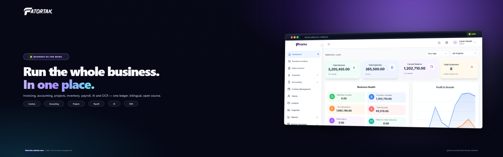

# Fatortak Marketing



The marketing department for **Fatortak**, the open-source, Arabic-first business OS.
This repository contains the landing page, the social content system, the production
marketing portal and the brand assets. It is separate from the product repository:
[Fatortak/Fatortak_Software](https://github.com/Fatortak/Fatortak_Software).

- **Landing page:** <https://fatortak.rabbeh.com>
- **Production portal:** <https://fatortak.rabbeh.com/portal/> (private login)
- **Product repository:** <https://github.com/Fatortak/Fatortak_Software>
- **License:** AGPL-3.0

## What is here

| Path | Purpose |
| --- | --- |
| `landing/` | Static landing page, screenshots, demo video, brand covers and social cards |
| `portal/` | Production marketing portal: Node API, dashboard, PHP login/proxy and deploy scripts |
| `automation/` | Channel adapters, queue generation, rendering, reports and the legacy CLI |
| `content/` | Content queue and copy bank |
| `strategy/` | Positioning, launch plan, channel playbooks and metrics |
| `crm/` | Commercial funnel notes and templates |
| `deploy/` | Static landing deployment helpers |

## Production portal

The portal is live at <https://fatortak.rabbeh.com/portal/>.

- Password login with a signed, HttpOnly, Secure session cookie and rate limiting.
- HTTPS enforced; the Node service binds `127.0.0.1:4318`.
- PHP supervises the Node process and proxies the API and media.
- State, credentials, media and backups live in `App_Data` on the server, never in Git.
- The queue holds **90 posts at 3 per day** (09:00, 13:00, 19:00 Cairo) from
  2 November to 1 December 2026, with **37 unique visuals**.
- Dry run is off and the scheduler is armed. X needs API credits; Threads is
  blocked by Meta App Review. Facebook, Instagram, Mastodon, Bluesky and Dev.to
  are connected.

Portal deployment is documented in [`portal/deploy/README.md`](portal/deploy/README.md).
Build and deploy from `portal/`:

```powershell
powershell -ExecutionPolicy Bypass -File scripts/build-production.ps1
powershell -ExecutionPolicy Bypass -File scripts/deploy-production.ps1 -SkipProvision -Restart
```

Credentials are kept outside the repository in
`%USERPROFILE%\.config\fatortak\portal-production.txt`.

## Brand covers

The `landing/assets/brand/` directory contains the professional covers used across
the sites and social profiles:

| File | Size | Use |
| --- | --- | --- |
| `cover-og.png` | 1280×640 | GitHub social preview / Open Graph |
| `cover-readme.png` | 1600×500 | README banner |
| `cover-x.png` | 1500×500 | X header |
| `cover-facebook.png` | 1640×624 | Facebook Page cover |
| `cover-linkedin.png` | 1128×191 | LinkedIn company banner |
| `cover-youtube.png` | 2560×1440 | YouTube channel art (safe area) |
| `avatar.png` | 400×400 | Profile avatar |

Regenerate them with:

```bash
node landing/scripts/generate-brand-covers.mjs
```

The source template is `landing/.brand-cover.html`.

## Automation

The channel adapters live in `automation/src/` and are reused by the portal.
Posting is API-based where the platform allows it; Hacker News, Reddit and
Product Hunt remain manual or monitoring-only because unattended self-promotion
violates their rules.

The legacy queue CLI is still available:

```bash
cd automation
node src/cli.mjs validate
node src/cli.mjs post --dry-run
```

## Strategy references

- [`strategy/social-media-plan.md`](strategy/social-media-plan.md) — all-channel strategy, 90-day phases, calendar, AI/OCR sprint, playbooks and guardrails
- [`strategy/positioning.md`](strategy/positioning.md) — ICP, messaging, objections and pricing architecture
- [`strategy/launch-90-days.md`](strategy/launch-90-days.md) — launch phases and manual channel playbooks
- [`strategy/metrics.md`](strategy/metrics.md) — funnel, events, UTM and weekly dashboard
- [`strategy/commercial-funnel.md`](strategy/commercial-funnel.md) — demos, proposals and partner program
- [`strategy/contributor-growth.md`](strategy/contributor-growth.md) — GitHub and contributor plan

## Honest limits

- The portal cannot create accounts, accept platform terms, pass app review or enter an OTP.
- X posting needs API credits.
- Threads publishing needs Meta App Review or a Threads tester.
- LinkedIn company posting needs Community Management API approval and the registered legal entity details.
- Hacker News, Reddit and Product Hunt are intentionally not auto-posted.

## License

Fatortak is licensed under **AGPL-3.0**. See the
[product repository](https://github.com/Fatortak/Fatortak_Software/blob/main/LICENSE)
for the full license text.
