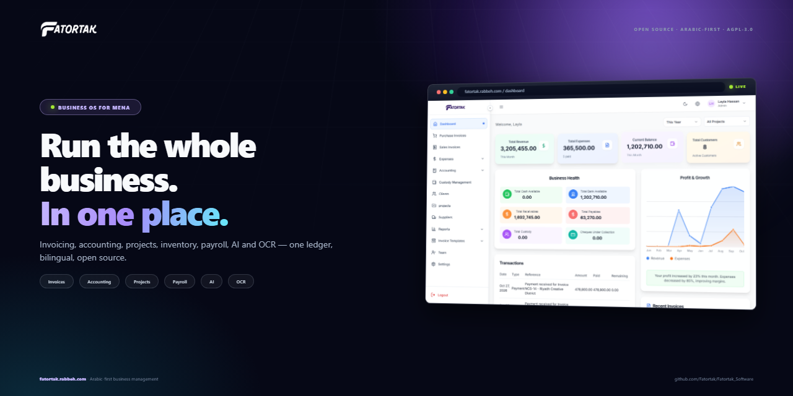

# Fatortak marketing portal



Production: **<https://fatortak.rabbeh.com/portal/>**

A control room for scheduling, publishing, monitoring and reporting across Fatortak's social channels.

It is intentionally one service with no build step:

- Node.js HTTP server + JSON store.
- Static dashboard with no frontend framework.
- Reuses the existing automation channel adapters.
- Dry-run by default; live publishing is locked behind an environment flag.
- Media is required by default: every post must carry an image or video.
- Secrets stay in `.env` outside the API; the portal never returns them.

> The portal can save and test credentials, but it cannot create social accounts, accept platform terms, pass app review or enter an OTP for you. That one-time identity step belongs to the account owner; after it, posting is automated.

## Run it

```powershell
cd portal
Copy-Item .env.example .env   # optional; fill only the channels you have
npm start
```

Open <http://127.0.0.1:4180>.

## Daily 10-post queue

`node scripts/build-daily-10.mjs <input-portal.json> <output-portal.json>` builds 360 posts at 12/day
(6 Arabic + 6 English, 08:00–21:30 Cairo) from 4 November to 3 December 2026, including **two video
posts per day** (10:15 and 16:15). It preserves posts before 4 November, assigns JPEG/MP4 media,
targets Facebook, Instagram, X, Bluesky, Mastodon and LinkedIn, and validates server limits, banned
claims, pricing and media.

The first two days lead with the refreshed UI, reports hub, data import, platform console, onboarding
and invoice-template themes. `landing/scripts/generate-social-v3.mjs` renders the 12 matching English
and Arabic cards from screenshots of the current app. `landing/scripts/generate-videos.mjs` renders the
12 vertical MP4s and posters into `landing/assets/videos/`.

The legacy `scripts/rebuild-queue.mjs` remains for the original 3/day queue.

The portal seeds itself from `content/queue.json` on first run. State is stored in `portal/data/portal.json`, which is gitignored.

## What the portal does

| View | What it shows |
| --- | --- |
| **Overview** | Alerts (overdue, failed, needs review, failing connection tests), next post, 14-day publishing strip, up-next agenda, publishing mode, audience, channel health and recent activity |
| **Content** | Status tabs with counts; search, date-range, channel, language, pillar and tag filters; sorting and pagination; bulk schedule/status/move days/add-remove channel/tag/duplicate/delete; row actions (approve, dry run, results, duplicate, publish, copy link) and filtered CSV export |
| **Calendar** | Month grid in the portal timezone; drag a post to another day to reschedule (with Undo); "+N more" day view; create a post on a given day; language/channel filters |
| **Media** | Uploads and the brand library with usage counts, drag-and-drop multi-upload with progress, copy URL, "new post from this", and delete (refused while unpublished posts use the file) |
| **Templates** | Reusable copy with default language, pillar and channels; create, edit, delete, and start a post from a template |
| **Inbox** | Comments on published posts from Facebook, Instagram, Bluesky and Mastodon (synced every 5 minutes on the live server, or with **Sync comments**). Tabs (open / new / replied / archived), channel filter, search (Arabic-aware), bulk mark read/archive, public reply, private DM, saved replies, matched comment rules and the 7-day DM window shown on each comment, "create a rule from this comment" |
| **Comment → DM rules** (Automations tab) | When a comment contains (any / all / exactly) keywords — Arabic or English — on chosen channels (optionally only posts with a tag), send a DM and/or a public reply from a template (`{{first_name}}`, `{{name}}`, `{{keyword}}`, `{{post}}`, link placeholders). Once per person, mark as replied, live tester, recipes (price, link, demo), stats |
| **Automations** | Rules that run around posts: **before** a post (N minutes), **after** it publishes (with optional delay), or **when it is scheduled** (e.g. a new offer). Filter by tag, pillar, language, channel or keyword. Actions: **Story** on Facebook/Instagram, or a **Post** (teaser, announcement, follow-up) on any connected channel from a template with `{{title}}`, `{{excerpt}}`, `{{time}}`, `{{date}}` and link placeholders. Recipes, dry-run Test, Run now, pause, run log |
| **Content health** | Score and fixes for the upcoming queue: repeated messages within 3 days, posts per day per channel vs recommended, Instagram links nobody can click, missing hashtags, too-long posts, missing media/alt text, question share, pillar and language mix; one-click recommended rules |
| **Trash** | Deleted posts kept 30 days; restore (as draft) or delete forever |
| **Post editor** | Two-pane drawer: copy with tracked-link placeholders, language (Arabic is RTL), pillar, tags, channel picker showing connection readiness, media (upload, drop, library, external URL, alt text), schedule quick picks, status with guidance, notes; live per-channel preview with platform character counting and **per-channel custom copy**; content checks; last publish and dry-run results; automations that apply to the post; revision history with restore; unsaved-change guard; Ctrl/⌘+S |
| **Connections** | Readiness bar and status buckets (ready / needs attention / not connected / can't automate); per channel: setup effort, what it supports (text, image, video, story, stats), step-by-step guide, field help with format checks before saving, test, disconnect, and **publishing rules** (daily cap, standard hashtags, Instagram "link in bio") |
| **Analytics** | Followers with 7/30-day growth and history chart, reach, engagement, clicks, posts, traffic by source. Every number shows its measurement window on hover |
| **Reports** | Delivery per channel from real publish results (published / failed / skipped / capped, success rate), top posts by engagement, recommendations, EN/AR and pillar mix, planned posts per channel, automation runs, CSV/JSON export |
| **Activity** | Searchable, filterable, paginated audit trail (last 1,000 events) linking back to posts |
| **Settings** | Dry-run (with a go-live confirmation), auto-approve, require media, live-site guard, timezone, public media host; changes are tracked and logged |

Keyboard: `N` new post, `/` search, `R` refresh, `G` then `O/C/K/M/T/A/S/R` to switch views, `?` for the list. Views are deep-linkable (`#/content?status=failed`, `#/content?post=<id>`, `#/calendar?month=2026-11`).

### Publishing rules worth knowing

- **Dry run never changes a post's status.** It stores the simulated result on the post (`preview`) and reports, per channel, whether it *would* publish or be skipped.
- **Character limits use each platform's counting.** X and Mastodon count every link as 23 characters (X also weighs emoji/CJK as 2); Bluesky counts graphemes. Counts are taken after `{{site}}`-style placeholders expand to their tracked URL, so the editor shows exactly what the publish check enforces.
- **A published post is not re-published by accident.** Publishing it again requires an explicit confirmation; retrying individual channels from Results is always allowed.
- **Edits are conflict-checked.** A save made from a stale copy (the scheduler or another tab changed the post) is refused with a prompt to overwrite or reload.
- **Interrupted publishes are flagged, not repeated.** A post left in `publishing` by a crash or restart is marked `failed` on startup so a person can check which channels already received it.
- **Channel rules apply everywhere.** Daily caps, hashtags and "link in bio" change previews, dry runs and real publishes alike. Caps limit only the scheduler; posts tagged `#priority` and manual publishes are never capped.
- **Stories exist on Facebook and Instagram only.** No other platform offers a Stories API; use a Post action for the rest. Stories carry media only (no captions or link stickers through the API). Instagram stories need a public https JPEG/MP4.
- **Automations run only in live mode** (`MARKETING_LIVE=true`, scheduler on, dry run off), act on each post at most once per rule, and never fire for events that happened before the rule was created.
- **Deleting moves to Trash.** Restored posts come back as drafts so nothing publishes by surprise.
- **Comments and DMs.** Reading comments is always safe; replies and DMs need `MARKETING_LIVE=true`, and rule DMs also need dry run off. Rules only act on comments written after the rule was created, at most once per comment and (by default) once per person. Facebook and Instagram DMs are official "private replies": they need `pages_messaging` / `instagram_manage_messages` (Meta app review), one per comment, within 7 days. Bluesky DMs need an app password with DM access; Mastodon DMs are direct-visibility posts. X, LinkedIn and Threads have no comment/DM API available to the portal.
- **Per-channel and story media.** `post.channelMedia[channel]` (`{ mediaUrl, mediaPublicUrl, mediaKind, mediaName, mediaAlt }`) replaces the main image/video for that channel only — e.g. a 4:5 card for Instagram and Facebook while X, LinkedIn, Bluesky and Mastodon keep the 16:9 main image. `post.storyMedia` is the 9:16 file Story automations use. Previews, dry runs, publishing and post automations all respect them; set them in the editor (each preview card's "Use a different image here", and the "Story version" row) or from the queue builder.
- **Design.** Light theme on CSS tokens in `public/styles.css` (`--primary: #0099cc`). Change colours there, never inline.

See [ROADMAP.md](ROADMAP.md) for the competitive gap review and the phased plan.

### Metric windows

| Channel | Reach | Engagement |
| --- | --- | --- |
| Facebook | Sum of per-post unique viewers for portal posts from the last 28 days | Reactions + clicks on the same posts |
| Instagram | Unique accounts reached in the last 28 days (account insights) | Likes + comments on the latest 50 posts |
| Bluesky | — | Likes + reposts + replies on the latest 30 posts |
| Mastodon | — | Favourites + boosts + replies on the latest 20 posts |
| Dev.to | Lifetime page views of published articles | Lifetime reactions + comments |

Totals add channels with different windows, so the dashboard labels them as such. Follower history is snapshotted once a day at metric sync.

## Channel automation matrix

### Fully automated posting

These have adapters in the portal. They publish when the corresponding API credentials exist and `MARKETING_LIVE=true`.

| Channel | Posting | Media | Monitoring | Credentials |
| --- | --- | --- | --- | --- |
| X | API v2 | Text via OAuth 1.0a; image upload; video poster fallback | Partial (elevated access may be required) | `X_API_KEY`, `X_API_SECRET`, `X_OAUTH1_ACCESS_TOKEN`, `X_OAUTH1_ACCESS_TOKEN_SECRET`; optional `X_ACCESS_TOKEN` for OAuth 2.0 text |
| LinkedIn company page | API | Image upload; video poster fallback | Organization statistics need app review | `LINKEDIN_ACCESS_TOKEN`, `LINKEDIN_AUTHOR_URN` |
| Facebook Page | Graph API | Image and video upload | Page Insights need app review | `FACEBOOK_PAGE_ID`, `FACEBOOK_PAGE_ACCESS_TOKEN` |
| Instagram Business | Graph API | Public image URL; video as Reels | Insights need app review | `INSTAGRAM_USER_ID`, `INSTAGRAM_ACCESS_TOKEN` |
| Threads | Threads API | Public image/video URL | Insights need app review | `THREADS_USER_ID`, `THREADS_ACCESS_TOKEN` |
| Bluesky | AT Protocol | Image and video upload | Public profile; post metrics later | `BLUESKY_HANDLE`, `BLUESKY_APP_PASSWORD` |
| Mastodon | API | Image and video upload | Public account metrics | `MASTODON_INSTANCE`, `MASTODON_ACCESS_TOKEN`, `MASTODON_ACCOUNT` |
| Telegram | Bot API | Image and video upload | Member count only | `TELEGRAM_BOT_TOKEN`, `TELEGRAM_CHAT_ID` |
| Discord | Webhook | Image and video upload | No native message analytics | `DISCORD_WEBHOOK_URL` |
| Dev.to | Forem API | Public cover image URL | Article views/reactions via API | `DEVTO_API_KEY` |

### Requires app review, audit or a media asset

| Channel | Reality |
| --- | --- |
| TikTok | Content Posting API requires an approved developer app audit and a video asset. The portal blocks it until then; it does not fake success. |
| YouTube | Needs OAuth, a video asset and API quota/audit. Text-only posts are not a YouTube format. |
| Instagram | Needs a public image/video URL for every post; text-only posts are blocked. |
| Threads | Needs a Threads API app and access token; image posts need a public URL. |
| WhatsApp | Opt-in template messages only. It is not a broadcast channel and cannot be fully automated for marketing. |

### Monitoring only, not automated posting

| Channel | Why |
| --- | --- |
| Hacker News | No posting API; automated self-promotion is against community norms. |
| Reddit | Subreddit rules prohibit unattended self-promotion; automation gets accounts banned. |
| Product Hunt | No public launch-posting API. |
| GitHub | Repository/release monitoring, not a social post channel. |

> **The honest answer to “nothing manual”:** every channel that allows API posting can be fully automated after a one-time OAuth/app connection. Hacker News, Reddit and Product Hunt do not allow compliant unattended posting. Automating them would risk the accounts. The portal monitors where possible and blocks the rest instead of pretending.

## Connect from the dashboard

1. Open **Connections**.
2. Click **Connect** on a channel.
3. Click **Open developer console** and create the app/token there.
4. Paste the values into the form and click **Save & test**.
5. The portal writes the values to `portal/.env`, reloads them in memory and verifies the connection. It never returns the secret.

This removes the manual file editing, but it cannot remove the platform's one-time identity step. Creating accounts, accepting terms, app review and OTP verification cannot be performed by the portal.

## Media

Text-only publishing is disabled by default (`mediaRequired: true`). The composer will not schedule or publish a post without an image or video.

- **Media library**: ten real Fatortak screenshots plus nine branded 1200×630 social cards generated from them. Queue posts are automatically matched to a relevant card or screenshot by pillar and language.
- **Upload**: images and videos up to 100 MB are stored in `portal/data/media/` (gitignored) and served from `/media/...`.
- **Native upload**: Facebook, LinkedIn, Mastodon, Telegram, Discord and Bluesky accept the file directly.
- **Image only**: X (OAuth 1.0a media keys).
- **Public URL required**: Instagram, Threads and Dev.to. Set **Public media host** in Settings or `PORTAL_PUBLIC_URL` to the public address of the portal, or attach a CDN URL. Local `127.0.0.1` URLs cannot be fetched by Meta.
- **Video**: Facebook, Instagram (Reels), Threads, Mastodon, Telegram, Discord and Bluesky. X and LinkedIn receive the video poster with a status note until their video uploads are enabled; the portal does not silently post text.
- **Alt text** is stored with every post and passed to channels that support it.

The real screenshots use `https://fatortak.rabbeh.com/assets/screenshots/...` as their public URL. Until the landing page is uploaded, Instagram/Threads/Dev.to cannot fetch them; native-upload channels can use the local copy.

## Connect the live profiles

| Profile | URL |
| --- | --- |
| Facebook | <https://www.facebook.com/people/Fatortak-%D9%81%D8%A7%D8%AA%D9%88%D8%B1%D8%AA%D9%83/61578152019660/> |
| Instagram | <https://www.instagram.com/fatortak.app/> |
| TikTok | <https://www.tiktok.com/@fatortak.app> |
| LinkedIn | <https://www.linkedin.com/company/fatortak/posts/> |

### Facebook Page

1. Create a Meta developer app at <https://developers.facebook.com/>.
2. Add the **Facebook Login** and **Pages API** products.
3. Request `pages_manage_posts`, `pages_read_engagement` and `read_insights`.
4. Generate a Page access token for the Fatortak page.
5. Set `FACEBOOK_PAGE_ID` and `FACEBOOK_PAGE_ACCESS_TOKEN`.

### Instagram Business

1. Convert the Instagram account to a Business or Creator account.
2. Link it to the Fatortak Facebook Page.
3. Request `instagram_basic`, `instagram_content_publish` and `instagram_manage_insights`.
4. Set `INSTAGRAM_USER_ID` and `INSTAGRAM_ACCESS_TOKEN` in the Connections wizard.
5. Every post needs a public image URL; videos are published as Reels.

### Threads

1. Create a Threads API app through Meta.
2. Request `threads_basic`, `threads_content_publish` and `threads_manage_insights`.
3. Set `THREADS_USER_ID` and `THREADS_ACCESS_TOKEN`.
4. Media must be a public https image or video URL.

### LinkedIn company page

1. Create a LinkedIn developer app.
2. Request `w_organization_social`, `r_organization_social` and `r_organization_admin`.
3. Authorize the Fatortak company page admin.
4. Set `LINKEDIN_ACCESS_TOKEN` and `LINKEDIN_AUTHOR_URN=urn:li:organization:<id>`.
5. Images upload natively; LinkedIn video is blocked until the video upload flow is added.

### X

1. Create an X developer app and set **Read and write** permissions.
2. Generate the **OAuth 1.0a** consumer key/secret and access token/secret for the Fatortak account.
3. Set `X_API_KEY`, `X_API_SECRET`, `X_OAUTH1_ACCESS_TOKEN` and `X_OAUTH1_ACCESS_TOKEN_SECRET`.
4. `X_ACCESS_TOKEN` is optional and only used for OAuth 2.0 text posts.
5. Add X API credits before enabling live posting; the API is pay-per-use.

### Bluesky

1. Open Bluesky **Settings → App passwords**.
2. Create an app password.
3. Set `BLUESKY_HANDLE` and `BLUESKY_APP_PASSWORD`.

### Mastodon

1. Create an access token in your Mastodon instance.
2. Set `MASTODON_INSTANCE`, `MASTODON_ACCESS_TOKEN` and `MASTODON_ACCOUNT`.

### Telegram and Discord

- Telegram: create a bot with @BotFather, add it to the channel as admin, set `TELEGRAM_BOT_TOKEN` and `TELEGRAM_CHAT_ID`.
- Discord: create a webhook in the channel and set `DISCORD_WEBHOOK_URL`.

### Dev.to

1. Create an API key in Dev.to **Settings → Extensions → DEV Community API Keys**.
2. Set `DEVTO_API_KEY`.

## Publishing safety

- The portal starts in **dry run**. No live API is called.
- `MARKETING_LIVE=true` unlocks live publishing.
- `PORTAL_AUTO_PUBLISH=true` enables the local scheduler. It only runs while the portal process is running.
- The scheduler publishes posts with status `scheduled` when their time is due.
- If `requireLiveSite` is on, posts containing `{{site}}` are blocked until `https://fatortak.rabbeh.com/` responds.
- If `mediaRequired` is on (default), posts without an image or video are blocked before any channel API is called.
- A post can be published manually with **Publish live** after confirmation.
- The portal never deletes a published platform post; deleting in the portal removes only the local record.

## Metrics and traffic

- Landing traffic: a cookie-less first-party counter (`track.php` + `stats.php`) records aggregate daily pageviews, referrer source and a daily visitor hash in `App_Data/traffic.json`. The portal reads it automatically. Raw IP addresses are not stored in the analytics file.
- Plausible is optional: set `PLAUSIBLE_SITE_ID` and `PLAUSIBLE_API_KEY` to use Plausible aggregate and a 30-day source breakdown instead.
- GitHub: stars/forks/open issues from the public API.
- Bluesky: followers/posts from the public profile.
- Mastodon: followers/statuses from the instance API.
- X, LinkedIn, Facebook, Instagram, Threads, TikTok and YouTube metrics require their respective APIs and app permissions. Until those are connected, the portal shows **needs setup** instead of a fake number.

## API

| Method | Path | Purpose |
| --- | --- | --- |
| GET | `/api/health` | Health check |
| GET | `/api/overview` | Dashboard payload |
| GET | `/api/meta` | Statuses, pillars, channel limits, placeholders, tags and the portal's current wall-clock time |
| GET | `/api/posts` | List/filter posts (`status`, `channel`, `lang`, `tag`, `pillar`, `q`); revision history omitted |
| POST | `/api/posts` | Create post |
| POST | `/api/posts/bulk` | Bulk `status`, `shift` (days), `addChannel`/`removeChannel`, `addTag`/`removeTag`, `duplicate`, `delete` |
| GET | `/api/posts/:id` | Full post with revisions and a per-channel preview |
| PUT | `/api/posts/:id` | Update post (send `updatedAt` to reject stale edits with 409) |
| POST | `/api/posts/:id/restore` | Restore a revision (`{ index }`) |
| POST | `/api/posts/:id/status` | Change status |
| POST | `/api/posts/:id/publish` | Publish now (dry-run by default; never changes status in dry run) |
| POST | `/api/posts/:id/duplicate` | Copy post as a draft |
| DELETE | `/api/posts/:id` | Delete local post |
| POST | `/api/preview` | Rendered text, platform length and warnings per channel |
| GET/POST | `/api/templates` | List / create templates |
| PUT/DELETE | `/api/templates/:id` | Update / delete a template |
| GET | `/api/activity` | Paginated audit trail (`type`, `q`, `postId`, `limit`, `offset`) |
| GET | `/api/comments` | Inbox (`status`=open/new/read/replied/archived, `channel`, `q`, `postId`, `limit`, `offset`) with matched rules and DM window |
| POST | `/api/comments/sync` | Fetch new comments now and run comment rules |
| PUT | `/api/comments/:id` | Set status |
| POST | `/api/comments/bulk` | Set status on many (`{ ids, status }`) |
| POST | `/api/comments/:id/reply` | Public reply (requires `MARKETING_LIVE`) |
| POST | `/api/comments/:id/dm` | Private message to the commenter (requires `MARKETING_LIVE`) |
| GET/POST | `/api/comment-rules` | List / create comment → DM rules |
| PUT/DELETE | `/api/comment-rules/:id` | Update (incl. pause) / delete |
| POST | `/api/comment-rules/:id/test` | Try a sample comment (`{ text, channel, name }`); nothing is sent |
| GET/POST/DELETE | `/api/saved-replies[/:id]` | Saved replies for the inbox |
| GET/POST | `/api/automations` | List rules, recent runs and story/post channels / create a rule |
| PUT/DELETE | `/api/automations/:id` | Update (incl. pause) / delete a rule |
| POST | `/api/automations/:id/test` | Dry-run a rule on the next matching post (or `{ postId }`) |
| POST | `/api/automations/:id/run` | Run it for real (requires `MARKETING_LIVE=true`) |
| GET | `/api/content/audit` | Content health: score, issues per post, volume per channel, suggestions |
| GET/DELETE | `/api/trash` | List deleted posts / empty trash |
| POST | `/api/trash/:id/restore` | Restore a post as a draft |
| DELETE | `/api/trash/:id` | Delete a post forever |
| DELETE | `/api/connections/:channel/credentials` | Disconnect a channel (removes its saved credentials) |
| GET | `/api/calendar?month=YYYY-MM` | Calendar posts |
| GET | `/api/connections` | Channel modes, setup links, media support and verification |
| PUT | `/api/connections/:channel/credentials` | Save whitelisted credentials to `.env` |
| POST | `/api/connections/:channel/test` | Verify the saved credentials |
| GET | `/api/media` | Uploaded files + screenshot library |
| GET | `/api/media/library` | Screenshot library only |
| POST | `/api/media` | Upload image/video (raw body, `X-File-Name` header) |
| DELETE | `/api/media/:id` | Delete an uploaded file (409 while unpublished posts use it; `?force=1` overrides) |
| GET | `/api/metrics` | Metrics + traffic |
| POST | `/api/metrics/sync` | Sync available metrics |
| GET | `/api/reports/summary` | Report payload |
| GET | `/api/reports/export?format=csv\|json` | Download export; accepts the same filters as `/api/posts` |

`PUT`/`DELETE` can also be sent as `POST` with an `X-Portal-Method` header — the production PHP proxy does this because IIS blocks those verbs.

## Tests

```powershell
npm test               # adapters (mocked HTTP) + portal API end-to-end
npm run test:portal    # boots server.mjs on a free port with a temp data dir, dry run, no credentials
```
| GET/PUT | `/api/settings` | Safe settings |
| POST | `/api/import-queue` | Import the 90-day queue |

## Security

- Binds to `127.0.0.1` by default.
- Set `PORTAL_ADMIN_TOKEN` before exposing it behind a reverse proxy. The API requires `Authorization: Bearer <token>`.
- Mutating API calls reject cross-origin requests (`Origin` must match the host), which blocks drive-by CSRF against localhost.
- Tokens are read from `automation/.env` and `portal/.env`; existing environment variables win.
- The Connections wizard writes only whitelisted keys to `portal/.env` (mode `0600`) and updates the running process without a restart.
- The portal never stores tokens in `portal.json` and never returns them from an API.
- Media uploads are stored in `data/media/` (gitignored) and served with `nosniff`, `SAMEORIGIN` and path-traversal protection.
- `data/`, `.env`, `export/` and `backups/` are gitignored.

## Extending

Add a channel adapter in `portal/adapters.mjs`:

1. Add a `post<Channel>` function.
2. Add the channel to `LIMITS`.
3. Route it in `publishToChannel`.
4. Add its credential checks in `connectionState`.
5. Add it to `CHANNEL_DEFS` in `server.mjs`.

Do not add an adapter for a platform that prohibits unattended posting. Use monitoring instead.
